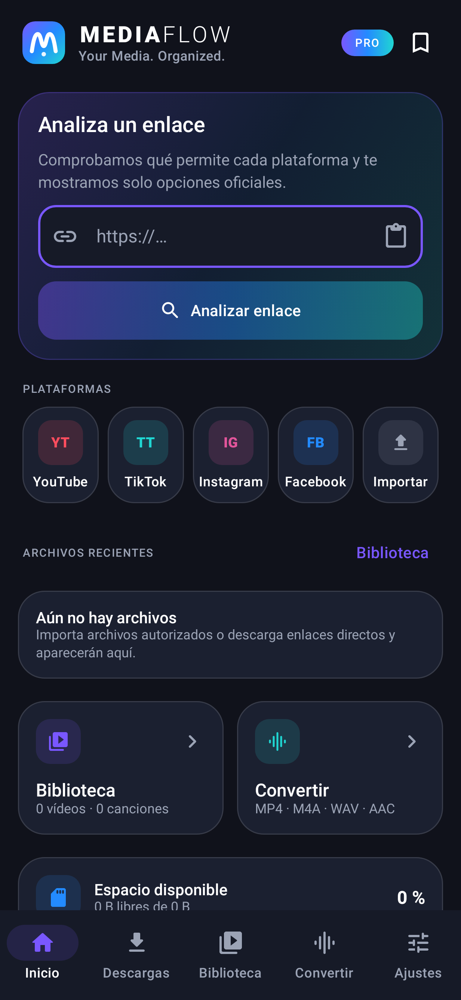
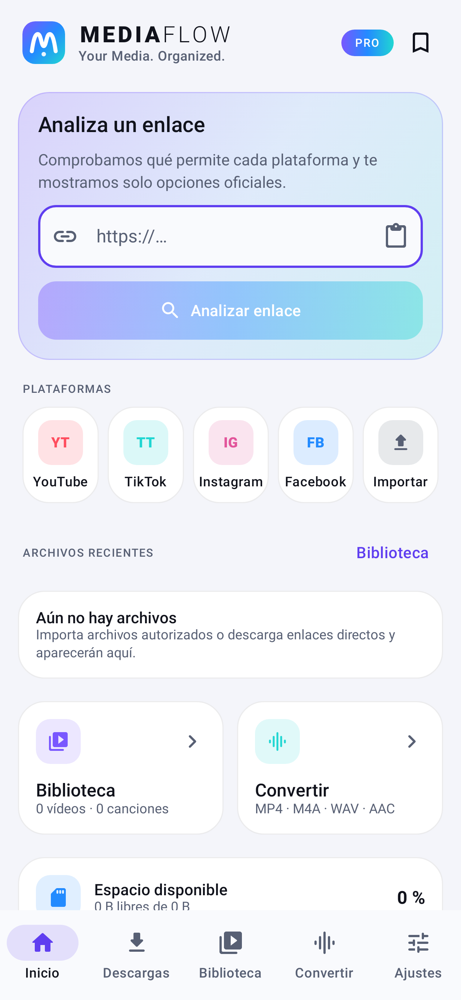
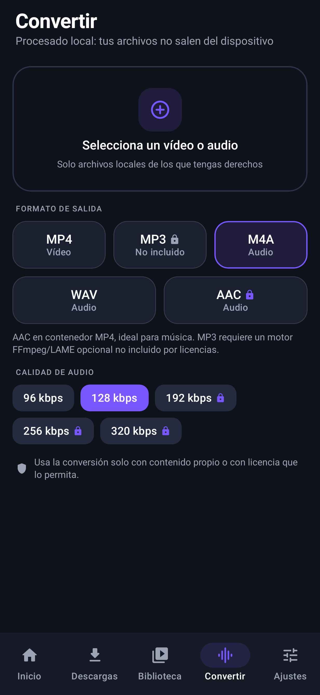
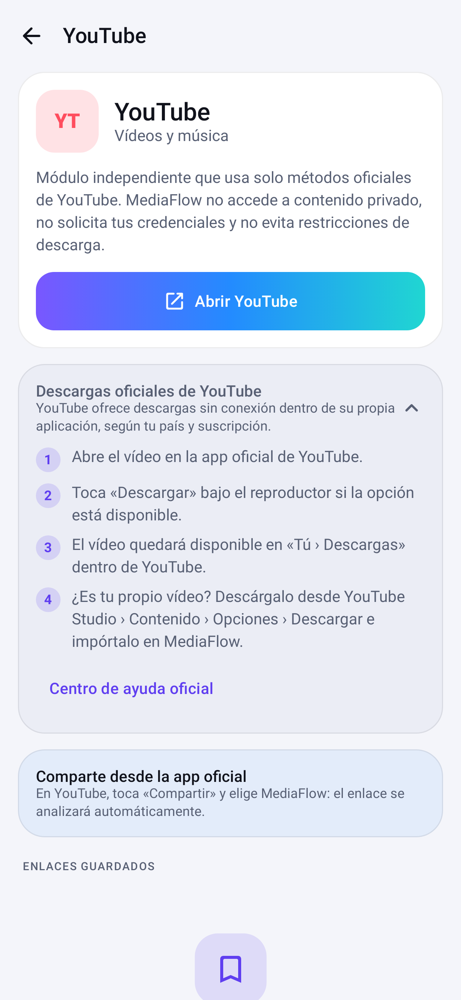

# MEDIAFLOW — *Your Media. Organized.*

Aplicación Android nativa (Kotlin + Jetpack Compose + Material 3) para **organizar, reproducir, convertir y descargar contenido multimedia mediante fuentes autorizadas**. Todo funciona en el dispositivo, sin servidor central.

**APK:** [`dist/MediaFlow-1.0.0-release.apk`](dist/MediaFlow-1.0.0-release.apk) (5,7 MB, Android 10+). Está firmado con una clave de depuración, así que vale para instalar y probar. Para publicar en Google Play hay que firmar con tu propia clave (ver *Firma*).

| Oscuro | Claro |
|---|---|
|  |  |
|  |  |

Hay más capturas en `docs/screenshots/`. Las genera `ScreensTest` ejecutando la app real con Robolectric.

## Módulos

```
app                      Application, MainActivity, DI manual (AppContainer), manifiesto, icono
core                     Sistema de diseño (colores, tipografía, componentes, logotipo), formateadores
domain                   Kotlin puro: modelos, contratos de repositorio, casos de uso, FeatureGate, validación de URL
data                     Room (descargas, favoritos, conversiones), DataStore (ajustes), OutputStorage (MediaStore/SAF)
presentation             Pantallas Compose + ViewModels (MVVM) y navegación
downloader               WorkManager + HTTPS real: progreso, velocidad, ETA, pausa/reanudación por Range
media_converter          MediaExtractor/MediaCodec/MediaMuxer: MP4 (remux), WAV, M4A, AAC
media_player             Media3 ExoPlayer + MediaSessionService (segundo plano, notificación, cola)
library                  MediaStore + SAF: vídeos, música, archivos; renombrar/eliminar con consentimiento
platform_integrations/
  api                    Contrato PlatformModule, registro, cliente oEmbed
  youtube | tiktok | instagram | facebook | direct   Un módulo Gradle independiente por plataforma
```

Dependencias: `presentation → (core, data, downloader, media_converter, media_player, library, platform_integrations:api) → domain`. `domain` no depende de Android.

## Plataformas: qué hace y qué no hace

| Plataforma | Metadatos | Acciones ofrecidas |
|---|---|---|
| YouTube | oEmbed oficial (título, autor, miniatura) | Abrir en la app oficial, guía de descargas oficiales (app / YouTube Studio), importar archivo, favoritos |
| TikTok | oEmbed oficial | Abrir en TikTok, «Guardar vídeo» si el creador lo permite, importar, favoritos |
| Instagram | — (su oEmbed requiere un token de Meta) | Abrir en Instagram, «Descargar tu información», importar, favoritos |
| Facebook | — | Abrir en Facebook, descarga de tus propios vídeos / «Descargar tu información», importar, favoritos |
| Enlace directo | Cabeceras HTTP (HEAD) | **Descarga real** solo si el servidor entrega públicamente un archivo de vídeo, audio, imagen o PDF por HTTPS |

No hay extracción de contenido de las plataformas, evasión de DRM, acceso a contenido privado ni almacenamiento de credenciales. Si el enlace es una página web, o el servidor responde 401/403, no se ofrece ninguna descarga. MediaFlow aparece en el menú **Compartir** de Android, así que los enlaces compartidos desde las apps oficiales se analizan automáticamente.

## Conversión
- **MP4:** copia de pistas sin pérdida (remux).
- **WAV:** PCM de 16 bits.
- **M4A / AAC:** codificación AAC-LC a 96–320 kbps con el códec del sistema.
- **MP3:** desactivado. Android no incluye un codificador MP3. El código ya define la interfaz `ExternalEncoder` para añadir un build de FFmpeg/LAME bajo LGPL, pero no se distribuye en esta compilación para no incumplir su licencia.

El progreso se calcula a partir de las marcas de tiempo reales. El tamaño estimado sale de la duración y la tasa de bits.

## Gratis y Premium
`domain/model/Entitlement.kt` (`FeatureGate`) define las reglas en un solo lugar:
- **Gratis:** MP4/M4A/WAV hasta 15 min y 128 kbps.
- **Premium:** AAC, hasta 320 kbps, sin límite de duración, ordenación y filtros avanzados, temporizador de apagado, velocidades de 2,5–3× y sin anuncios.

`EntitlementRepository` es el punto donde se conectará **Google Play Billing**. `PREMIUM_PREVIEW` (en `app/build.gradle.kts`) activa un interruptor de *vista previa* para pruebas; ponlo a `false` antes de publicar. AdMob no está integrado: la app no muestra anuncios.

## Seguridad y permisos
- Solo se aceptan enlaces HTTPS. Se rechazan las credenciales embebidas, los hosts locales o privados y el tráfico en claro (`network_security_config`).
- `READ_MEDIA_VIDEO` y `READ_MEDIA_AUDIO` se piden solo desde la Biblioteca. Sin ellos, la app ve sus propios archivos.
- Las notificaciones se piden al iniciar la primera descarga.
- La app guarda vía MediaStore (no necesita permisos de escritura) o en la carpeta que elijas con SAF.
- Las copias de seguridad están desactivadas (`allowBackup=false`) y no hay analíticas.

## Compilar
Requisitos: JDK 17+ y Android SDK 35.
```bash
./gradlew :app:assembleRelease        # APK firmado (clave debug si no hay keystore.properties)
./gradlew :domain:test :app:testDebugUnitTest   # tests + capturas de pantalla
```
### Firma
Crea `keystore.properties` en la raíz (está en `.gitignore`):
```
storeFile=mi-clave.jks
storePassword=...
keyAlias=...
keyPassword=...
```
